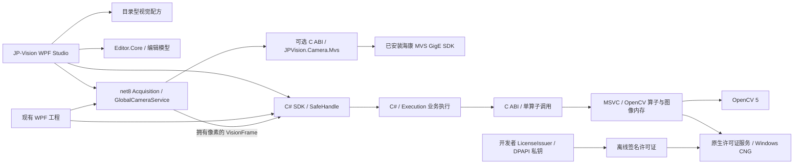

# 架构与接口契约

## 组件

Runtime 不引用 Qt、WPF 或相机 SDK。Studio 和 WPF 使用相同配方与算法。Editor.Core 负责编辑、接口和模板编码；默认正式执行由 SDK 中的 C# Execution 层驱动。

`ManagedExecutionPlan` 编译数据连接和参数依赖，决定实际执行的祖先子图、顺序及引用计数；`ManagedBindings` 和 `ManagedExpression` 处理本次变量、函数、参数订阅与坐标来源；`ManagedExecution` 负责调度、运行状态、调试结果、输出发布及最终判定。输入图像、有效掩膜、不可变图像上下文和 OpenCV 特征仍由原生内核持有，通过不透明句柄传递。C# 每次明确指定一个算子，原生桥不自行遍历流程。

原 C++ 全流程入口保留为 `VisionExecutionBackend.Native`，用于旧 C ABI 调用方兼容及对照测试；WPF 和原有 `new VisionEngine(...)` 默认走 `Managed`。配方内容哈希、外部资源安全校验、算子参数与像素资源上限、机器绑定授权仍在原生边界检查，C# 调度不能绕开这些约束。迁移范围与验证见 [C# 业务执行层](managed-execution.md)。

组件描述、算法与校验统一到 ComponentRegistry。execute／expand 保留旧零／单输入适配；新增 executeInputs 接收完整 InputValues，expandInputs 使用真实输入附加图像投影。端口按 node+port 取值，参数字段也参与同一 DAG 和引用计数。见 [本轮契约](m0-m2-implementation.md) 和 [组件开发](component-authoring.md)。

Studio 为 .NET 10 WPF，Runtime 为 MSVC，双方通过现有 net8 SDK 只交换 C 整数、UTF-8 JSON、字节数组和 opaque handle；不交换 STL、cv::Mat、Qt 对象或跨分配器释放内存。

## 全局相机采集

`JPVision.Acquisition` 与算法 Runtime 分离：`MvsCameraProvider` 经可选原生桥接调用已安装 MVS，桥接不依赖 OpenCV Runtime，不复制厂商 DLL。缺少相机模块／SDK 时文件源与算法不受影响。`GlobalCameraService` 管理单台海康 GigE 的连接、连续取流、单槽最新预览及业务请求后的新帧；SDK 缓冲及时释放，检测帧复制为拥有像素的 Gray8／Bgr24，再送入现有 Session。服务和执行仍检查机器绑定许可证。

WPF 的所有 ExternalImage 节点共享同次执行的一张全局帧，预览不驱动配方、不覆盖固定的教学／结果图。检测等待有超时并拒绝并发请求，停止／故障清缓存且变更采集代际，不能复用旧帧完成新请求。编辑器用包含 SN、帧号及接收 QPC 的 FrameId 关联运行；本机源模式与 SN 保存在独立 camera.json，不随配方保存，不自动连接。当前仅自由连续取流，未接入硬件触发、多相机或大恒。详见 [相机图像源与 SDK](camera-source.md)。

## 执行

Engine → Recipe → Session → accepted Run → Result。Recipe 保存不可变计划；Run 持有接受时的帧、参数与父对象引用。Session 一次只接受一个未完成 Run，重入返回 Busy；每进程同时接受的任务受 `min(max(hardwareConcurrency/2,1),8)` 限制。OpenCV 首次初始化采用 2 个线程，不实现节点并行。

执行前检查原生授权、图结构、参数覆盖、类型与必连输入。仅执行公开输出及已声明 previewNodes 的祖先子图，同时拒绝文件中任意结构环路。输入优先级为本次显式值高于配方默认值，未声明的输入与错误类型明确报错。

执行状态和业务判定分开：Succeeded 根据明确的 Bool 或 Decision 输出判定；必要祖先跳过、输入不可用或未配置规则为 Unknown。Failed、Cancelled、TimedOut 的判定为 Unknown，公开输出为空。异常、改图或换图会清除旧结果。

取消绑定某个 Run，不能影响下一次任务。取消与超时在节点前后协作检查，不能强行打断正在运行的单个 OpenCV 函数。SDK 必须等待原生执行收尾后才完成取消或超时 Task；没有使用假超时提前释放输入。关闭忙碌 GUI 会先取消并等待。

## 所有权与线程

- C ABI 创建的每个 handle 用对应 release 释放一次。释放父级不破坏已接受任务的共享数据；Session release 会请求取消。
- 调用者不得传错 handle 类型、使用已释放 handle，或与使用同一个裸 handle 的调用竞争释放。C# SafeHandle 为 P/Invoke 的调用时间保活。
- 所有输出 JSON 字符串由 Runtime 分配，用 `vision_string_free` 释放；last_error 是当前线程的借用字符串，应在下一个原生调用前读取。
- `vision_frame_copy` 立即复制像素，支持正 stride 的 Gray8/Bgr24；帧不可变。图像上限 32MP / 128MiB，外部 origin 范围 ±32768，尺寸单轴 ≤32768。
- 默认结果保留公开输出和已执行检测节点的当前轻量测量（32 MiB 总预算）；失败清空两者。Debug 模式额外保留中间图和节点值，总预算 256MiB；轮廓最多 10000 条、1000000 个点。
- WPF 的 PresentCopy 在 UI Dispatcher 调用，它复制图像和图元，调用后即可释放原帧与结果。后台视觉计算不访问 WPF 控件。

`vision_diagnostics` 返回当前进程在用的 native handle、输出字符串和活动 Run 数；字符串统计是分配诊断响应前的快照。它用于趋势检查，不等同于操作系统所有句柄或 OpenCV 内部全部分配计数。

## 安全与持久化

许可服务在原生核心验签与比较本机硬件指纹。UI/SDK 不提供 isLicensed、外部 machineId 或可替换验签公钥参数。许可证导入先验签，再写唯一临时文件、flush、原子替换；同进程导入串行，Windows 短暂替换冲突有限重试，失败返回 StorageAccessDenied 并保留旧文件。每次受保护调用重新读取许可内容摘要，不永久信任 UI 缓存。

JSON 限制体积和层数，重复字段拒绝；配方节点 ≤1024、连接 ≤4096、公开接口每类 ≤64、资源 ≤128、单资源 ≤32MiB。资源必须在配方目录内，通过路径规范化和 SHA-256 校验。没有执行任意脚本、动态下载节点或加载任意第三方 DLL 的接口。

原生状态码 0 为成功；1–8 为参数、配方、Busy、Disposed、资源、内部错误、取消和超时；100–109 为 Missing、InvalidFormat、InvalidSignature、UnknownKey、MachineMismatch、WrongProduct、FeatureNotLicensed、UnsupportedVersion、MachineIdUnavailable、StorageAccessDenied。许可证状态查询本身成功时，状态 JSON 中的 code 仍可能非零，调用者必须检查 IsValid。

## 后续扩展

新增厂商继续实现采集 provider／桥接，转换为同一帧契约，不让算法 Runtime 依赖厂商 SDK；添加算法必须同时更新 catalog、参数校验、执行器、回归样本和节点版本。重大 ABI 或配方格式变化应提高版本并提供迁移。产线需要故障隔离时可以在稳定 SDK 契约后增加独立 Runtime Host，此版本尚未实现。
