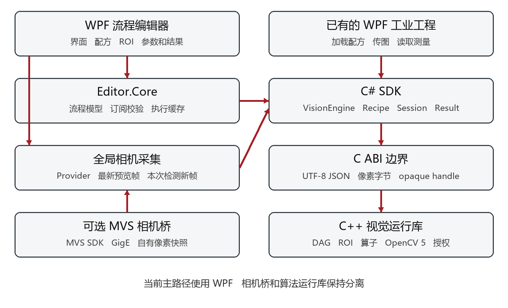
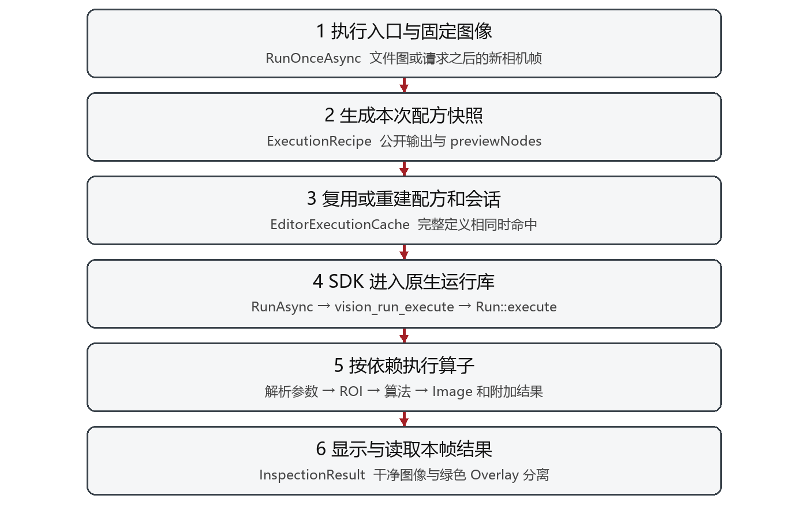
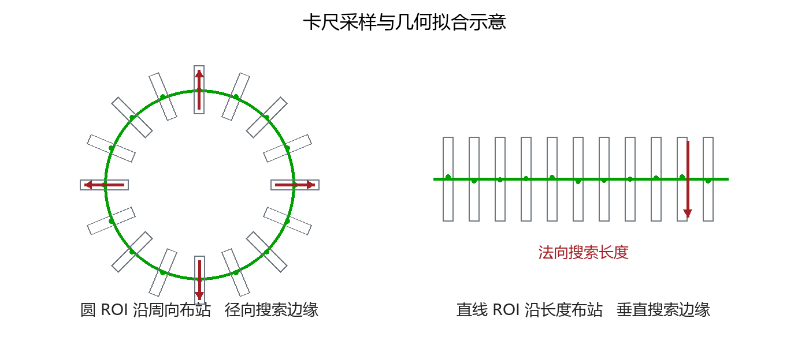

# JP Vision 代码逻辑与算子算法导读

2026-10-23 架构更新：默认流程调度、参数订阅、变量／函数和结果汇总已迁至 `managed/JPVision.Sdk/Execution`，OpenCV 算子仍在原生内核。阅读本文第 2～5 节时，请同时参照 [C# 业务执行层](managed-execution.md)；原 C++ 全流程说明对应保留的 Native 兼容入口。本文的原生算子算法说明仍可参考，既有 PDF／Word 为原日期快照。

依据 2026 年 10 月 21 日当前源码与原生算子目录整理。工程版本号为 0.7.2。阅读对象是熟悉 C# 工业软件、希望理解和扩展本项目的开发者。

这份导读解释代码当前怎样工作，而不是描述海康 VisionMaster 或 Cognex VisionPro 的内部实现。算子名称相近，并不表示算法、精度、性能和工业验证程度相同。既有设计文档包含历史版本内容；遇到差异，应以当前源码、运行时 catalog 和本导读的实现说明为准。

阅读后应能回答四个问题：点击执行后调用了哪些模块，图像和检测结果怎样沿连线传递，某个算子怎样从像素得到测量值，以及增加算法时应该修改哪里。本文中的距离默认使用像素；毫米等真实单位需要明确的标定与换算，不能把像素直接当成机械尺寸。

## 1 建议的阅读顺序

先看第 2 至第 5 节，建立编辑器、SDK、原生执行器和图像结果的关系；再选择自己常用的算子阅读。找圆、找线和边缘点集需要重点理解卡尺的采样方向、投影宽度、搜索高度与拟合验收条件。最后按照扩展步骤，从中值滤波这种简单算子开始对照代码。

| 想理解的事情 | 首先打开的源码 | 继续追踪的位置 |
|---|---|---|
| 程序如何启动和点执行 | `managed/JPVision.Studio.Wpf/MainWindow.xaml.cs` | `RunOnceAsync`、`ExecuteAsync` |
| 拖拽连线和配方保存 | `managed/JPVision.Editor.Core/FlowDocument.cs` | `Connect`、`PublishedRecipe`、`ExecutionRecipe` |
| C# 如何进入 C++ | `managed/JPVision.Sdk/Vision.cs` | `Native.cs` → `native/capi/runtime.cpp` |
| 图怎样被调度执行 | `native/core/graph.cpp` | `compile_recipe`、`accept_run`、`Run::execute` |
| 参数面板从哪里来 | `native/core/components/component.cpp` | 各组件注册函数、`NodeCatalog.cs` |
| 算法实际计算 | `native/core/components` | 对应的 `*_components.cpp` |
| 图像为何能携带圆心等数据 | `native/core/image_pipeline.cpp` | `complete_image_pipeline`、`image_context_value` |
| 相机实时画面如何显示 | `managed/JPVision.Acquisition/GlobalCameraService.cs` | `PumpAsync`、`MainWindow.CameraDisplay.cs` |

表中的路径相对于 `D:/open500/JP-Vision`。正文源码链接提供本机绝对路径与整理时行号；后续改动后行号可能移动，因此同时保留函数名供 VS 搜索。

## 2 项目由哪些部分组成

当前默认界面是 C# WPF。C++ 负责视觉运算，C# SDK 负责可靠地调用原生接口。`native/studio` 保存旧 Qt 编辑器实现，供迁移参考；当前 F5 主路径使用 `JPVision.Studio.Wpf`。



| 层次 | 项目或目录 | 主要责任和技术 |
|---|---|---|
| 编辑器界面 | `managed/JPVision.Studio.Wpf` | .NET 10 WPF、XAML、画布、ROI 编辑、参数面板、显示与交互；`MainWindow` 按功能拆为多个 partial 文件 |
| 编辑模型 | `managed/JPVision.Editor.Core` | .NET 8、JSON 配方、类型连接、撤销重做、参数订阅、模板编码和执行缓存；不执行 OpenCV 算法 |
| 托管调用层 | `managed/JPVision.Sdk` | .NET 8、P/Invoke、SafeHandle、帧封装、异步执行、强类型结果解析 |
| 可复用显示控件 | `managed/JPVision.Wpf` | WPF 图像与 Overlay 复制显示，供已有 WPF 工程集成 |
| 相机采集层 | `managed/JPVision.Acquisition` | 厂商 provider 接口、全局相机状态机、最新帧和请求新帧 |
| 相机原生桥 | `native/camera` | 可选 MVS C ABI 桥接；单独 DLL，负责相机 SDK 缓冲和像素格式转换 |
| C ABI 边界 | `native/capi` | `vision_api.h` 对外导出稳定的 C 函数，`runtime.cpp` 转换错误、句柄和 JSON |
| 图与算法 | `native/core` | C++20、OpenCV 5、图编译、ROI、坐标变换、结果传递、参数表达式和组件计算 |
| 离线授权 | `native/licensing`、`tools/LicenseIssuer` | 本机绑定、ECDSA P-256 与 SHA-256 验签；签发工具与客户运行库分离 |
| 构建与验证 | 根目录解决方案、`CMakeLists.txt`、`scripts`、`managed/JPVision.Tests` | MSVC/CMake 原生构建、.NET 构建、xUnit 和原生契约验证 |

核心边界只交换像素、UTF-8 JSON、整数和不透明句柄。不会把 `cv::Mat`、STL 对象或 WPF 控件直接跨 DLL 传递；创建者通过对应接口释放自己分配的对象。这能让你现有的现代 .NET WPF 工程直接调用相同算法核心。

源码入口：[C ABI 声明](D:/open500/JP-Vision/native/capi/vision_api.h:41)、[原生图与数据类型](D:/open500/JP-Vision/native/core/graph.h:34)、[托管 SDK](D:/open500/JP-Vision/managed/JPVision.Sdk/Vision.cs:97)、[构建依赖](D:/open500/JP-Vision/CMakeLists.txt:80)。

## 3 从启动到一次执行

### 启动和编辑

`App.OnStartup` 创建主窗口。`InitializeAsync` 检查编辑器和运行库授权，创建 `VisionEngine`，读取原生 catalog，再创建空白 `FlowDocument` 并构造工具箱。当前启动默认是空白的“未命名配方”；只有明确传入 `--recipe` 才在启动时加载指定配方。默认示例图像和默认配方是两件独立的事，图像区仍可显示示例图。

插入算子时，`FlowDocument.Add` 从 catalog 取参数。这里使用 `editorDefault` 优先于原生 `default`，所以界面新建节点的默认选项可能与旧配方缺省参数不同。连接时根据真实端口 ID、可接受类型和依赖关系检查，禁止自连和环路。画布显示的一个 Image 端口只是可见接口，底层仍保留兼容旧配方的类型端口。

源码入口：[启动逻辑](D:/open500/JP-Vision/managed/JPVision.Studio.Wpf/MainWindow.xaml.cs:84)、[空白编辑模型](D:/open500/JP-Vision/managed/JPVision.Editor.Core/FlowDocument.cs:27)、[参数默认值](D:/open500/JP-Vision/managed/JPVision.Editor.Core/NodeCatalog.cs:84)、[组件注册包装](D:/open500/JP-Vision/native/core/components/component.cpp:58)。

### 执行调用链



1. “执行”进入 `BusyAsync` 和 `RunOnceAsync`，限制重复点击，结束 ROI 编辑并清除上次结果。
2. 文件模式使用当前固定图像；全局相机模式先等待本次请求之后收到的新帧。所有 ExternalImage 节点共享这一次运行的同一帧。
3. `FlowDocument.ExecutionRecipe` 生成本次快照。公开输出未配置或引用失效时，根据末端节点生成当前输出；未被公开输出覆盖的末端支路通过 `previewNodes` 纳入编辑器执行。
4. `EditorExecutionCache` 比较完整定义 JSON。完全相同时复用一个 `VisionRecipe` 和 `VisionSession`；改变参数、连线或其他定义内容则重新封存、校验、加载。它不缓存图像、请求或运行结果。
5. SDK 创建 `Run`，在后台进入原生执行。`compile_recipe` 已将图变成计划，`Run::execute` 按计划读取各输入、解析参数订阅、执行组件、补齐图像与附加结果，然后保留需要的输出。
6. SDK 返回 `InspectionResult`。WPF 更新节点耗时和状态，选择节点显示图像、绿色标记和结构化结果表；结果显示与算法处理分别计时。

图编译使用带访问标记的深度优先遍历，数据连线和参数订阅都是依赖边。先检查整个文件是否存在环，再只记录公开输出与 `previewNodes` 的祖先子图。原生 SDK 不会因为某节点画在画布上，就自动执行所有无关节点。

源码入口：[执行入口](D:/open500/JP-Vision/managed/JPVision.Studio.Wpf/MainWindow.xaml.cs:241)、[输出自动整理](D:/open500/JP-Vision/managed/JPVision.Editor.Core/FlowDocument.cs:287)、[执行缓存](D:/open500/JP-Vision/managed/JPVision.Editor.Core/EditorExecutionCache.cs:61)、[计划编译](D:/open500/JP-Vision/native/core/graph.cpp:190)、[节点执行循环](D:/open500/JP-Vision/native/core/graph.cpp:592)。

### 成功执行与检测合格是两件事

`executionStatus=Succeeded` 表示这次计算正常完成；`decision=Pass/Fail/Unknown` 表示配方声明的业务判定。纯处理配方可以成功但判定为 Unknown。找不到目标也不一定是程序异常，可能是数量为 0、`selectedValid=false` 或某测量无效。

检测组件的 `passed` 通常来自其配置的数量范围，不代表圆拟合精度、零件所有尺寸或整个配方都合格。测量组件的有效性、上下限判定和配方最终 decision 需要分别检查。失败、超时、取消或换图后不能继续使用上一次的圆心和尺寸。

## 4 图像和结果怎样传递

### 一个 Image 端口包含什么

原生 `Image` 除了 `cv::Mat pixels`，还包含原点 `x/y`、有效像素掩膜 `valid`、数据是否可用、模板定位信息 `matchPosition`、位置修正 `fixture`、坐标平面信息和共享的 `pipelineContext`。

`configure_image_component` 把面向用户的端口整理为 Image，并保留隐藏的 Features、Measurement、Result、Pose 等结构。`complete_image_pipeline` 在算子结束后，把本节点结果和上游结果附着到输出图像上。下游算子可以从 Image 中提取自己需要的类型，避免“快速匹配结果不能连接圆查找”一类单纯端口不匹配。

这不表示所有算子都会改变像素。高斯滤波、二值化、形态学和圆环展开会产生相应处理图；找圆、找线和距离测量主要生成几何或测量数据，输出的是携带这些数据的干净图像。绿色圆、点、线属于独立 Overlay，不烧进下一算子的像素。

上下文以当前帧身份约束来源，并保存各节点的阶段结果。同一类型的便捷读取默认使用下游最近一次结果；最新的空结果也会覆盖同类旧结果，防止本帧没找到却沿用旧圆。需要区分同类型多个对象时，应使用明确的节点和端口绑定，而不是依赖“最近一个圆”的含义。

这里的同类型指 `Features`、`Measurement`、`Result` 等存储类型，不是圆、直线等几何种类。例如圆查找后接直线查找，最近的 `Features` 已是直线，`GetCircles(imageOutput)` 不会自动向前寻找早先的圆。要同时保留两个对象的业务含义，应明确绑定对应节点结果。

源码入口：[图像端口适配](D:/open500/JP-Vision/native/core/components/image_components.cpp:28)、[补齐图像与结果](D:/open500/JP-Vision/native/core/image_pipeline.cpp:259)、[上下文查询](D:/open500/JP-Vision/native/core/image_pipeline.cpp:490)、[SDK 读取附加数据](D:/open500/JP-Vision/managed/JPVision.Sdk/ImagePipeline.cs:9)。

### ROI 坐标和测量坐标

普通 ROI 参数通常相对于本算子的输入图像。例如输入图已经裁剪到原图的 `(1000,500)`，ROI 内局部点 `(20,30)` 在原图中为 `(1020,530)`。裁剪通过原点累加维持这个关系，检测输出通常返回原图坐标。

矩形、圆、多边形等 ROI 还可以提供有效像素掩膜，不能把其包围框里所有像素都当成有效区域。部分越出图像的 ROI 会按当前边界规则取交集；完全无有效图像的 ROI 不应产生测量值。圆和线卡尺的 ROI 边界是参考采样路径，窗口需要跨边界取样，因此与普通裁剪规则不同。

`PositionFixture` 提供参考位置到当前目标的坐标变换，供声明使用 fixture 的下游 ROI 跟随物品。`AnnularUnwrap` 则产生新的展开像素平面，属于非线性变换。展开图中的点不能直接和原图直线做距离；必须先检查 `coordinateSpace`、`coordinatePlane`，并使用正确映射或在同一平面内测量。

源码入口：[ROI 实现](D:/open500/JP-Vision/native/core/roi.h:7)、[模块 ROI 包装](D:/open500/JP-Vision/native/core/components/component.cpp:87)、[图像坐标字段](D:/open500/JP-Vision/native/core/graph.h:34)。

### 圆心结果和显示圆环

卡尺上的采样窗口、检测出的边缘点、拟合得到的圆、显示用的圆环，是四种不同数据。点已经呈圆形仍可能不满足最少内点、覆盖率或最大残差，因而目标数为 0；此时不应把诊断点当成已验收圆。

拟合成功后，圆心和半径来自保留内点的拟合。`outputAnnulusWidth` 只在该拟合半径两侧建立输出带宽，不表示又测到了另一条内外物理边缘。默认结果颜色为 `#00FF00`。想看一条拟合圆，应区分输出带宽与 Overlay 线宽；线宽的合法范围由 catalog 校验，不能把任意线宽参数设为 0 来代替“隐藏图元”。

## 5 算子目录和共同处理步骤

本次从 `JPVision.RuntimeCli catalog` 导出的当前目录共 32 类算子，其中 26 类在工具箱可见，6 类为旧配方兼容而隐藏。后面的算子说明覆盖全部 32 类。隐藏不等于没有实现，也不建议为了显示旧节点而直接修改原生端口契约。

典型算子的处理顺序是：填充并验证参数 → 解析订阅和坐标基准 → 准备 ROI 与有效掩膜 → 调用算法 → 生成结构化结果 → 补齐 Image 和 Overlay → 交给执行器保存输出。部分组件使用完整多输入回调，会显式处理 A/B 对象；不能假设每项都只经过同一单输入包装。

原生 catalog 是参数名称、类型、范围、可绑定性、枚举和端口定义的统一来源。`NodeCatalog` 负责把它读成 C# 模型；WPF 参数编辑器根据元数据和少量专用面板生成控件。因此改界面文本框的上限，并不等于原生算法已接受更大工作量。

下面按实际用途组织，而不是完全按源文件顺序排列。

## 6 输入与基础图像处理算子

这一组算子主要位于 `basic_components.cpp`。下文的“内部结果”指算法真正产生的类型；编辑器统一把可见输出整理成 `image`，图像中还携带本次流程的结果上下文。绿色 Overlay 单独传递，不烧录到图像像素中。“隐藏兼容算子”仍能执行旧配方，只是不再出现在左侧工具箱。

### 外部图像 ExternalImage

**作用与输入输出。** 这是流程入口，没有上游端口，把本次运行传入的 `Image` 作为输出。当前运行库要求恰好一个公开 Image 输入；`input` 参数默认是 `InputImage`，必须对应配方公开图像输入的名称。

**实现。** 算法回调直接返回 `original`，不自行读文件、打开相机或做像素运算。文件图像与全局相机的选择由 WPF 在调用运行库之前完成，因此更换图像来源不需要更换后续算子。

**读代码。** [算子注册与回调](D:/open500/JP-Vision/native/core/components/basic_components.cpp:16)；[公开图像输入约束](D:/open500/JP-Vision/native/core/graph.cpp:155)；[输入名称校验](D:/open500/JP-Vision/native/core/graph.cpp:223)。

### 灰度转换 ToGray

**算法。** 默认调用公共 `gray_pixels`，彩色图使用 `cv::cvtColor(..., COLOR_BGR2GRAY)`；也可使用 `cv::extractChannel` 单独取蓝、绿、红通道。输入已经是 Gray8 时直接沿用其灰度数据。

**参数与输出。** `channel=luminance` 为默认亮度灰度；另外三个值是 `blue/green/red`。输出为同尺寸 Gray8 图像，保留坐标原点。它没有检测几何目标，后面接圆查找、边缘提取或分割才产生相应结果。

**读代码。** [ToGray](D:/open500/JP-Vision/native/core/components/basic_components.cpp:19)；[gray_pixels](D:/open500/JP-Vision/native/core/components/component.cpp:51)。

### 高斯滤波 GaussianBlur

**算法。** `cv::GaussianBlur` 对邻域做高斯加权平滑，减轻高频噪声。输入输出尺寸和 Gray8/Bgr24 格式保持一致；这是真正改变图像像素的预处理。

**关键参数。** 核宽 `kernel` 默认 5，范围 1～101，必须为奇数；核高 `kernelHeight=0` 表示跟随宽度，也可以单独设置奇数。`sigma=1.0`，`sigmaY=0` 让 OpenCV 沿用 X 的 Sigma。边界默认 `reflect101`，还可选反射、复制或常量。

**使用影响。** 大核能抑制噪声，也会把细小缺陷和边缘一起变模糊。对原来的二值图进行高斯滤波后，管线会清除“已是二值掩膜”的标志，因为像素通常已不再只有 0 和 255。

**读代码。** [GaussianBlur](D:/open500/JP-Vision/native/core/components/basic_components.cpp:30)；[二值标志判定](D:/open500/JP-Vision/native/core/image_pipeline.cpp:212)。

### 中值滤波 MedianBlur

**算法。** `cv::medianBlur` 用邻域像素的中值替换中心值，适合清除孤立亮点、暗点等脉冲噪声；不像高斯滤波那样计算加权平均。当前实现只有一个核尺寸参数，默认 3，允许 3～31 的奇数。

**输入输出与扩展价值。** 同尺寸 Image → Image，Gray8/Bgr24 均由统一图像组件封装承接。它是“增加一个简单 OpenCV 算子”的最短完整示例：注册描述、列参数、写回调，再把结果矩阵返回即可。

**读代码。** [register_custom_components](D:/open500/JP-Vision/native/core/components/custom_components.cpp:6)；[add_image 的尺寸和格式检查](D:/open500/JP-Vision/native/core/components/component.cpp:242)。

### 二值化 Threshold

**算法。** 先转灰度，再根据 `method` 选择固定阈值、Otsu、Triangle、局部均值或局部高斯阈值。前三者通过 `cv::threshold` 实现；有非矩形有效掩膜时使用 `cv::thresholdWithMask`，不让 ROI 外像素进入该阈值计算。后两者使用 `cv::adaptiveThreshold`。

**关键参数。** 默认 `method=fixed`、阈值 `value=128`、`invert=false`；反向后暗目标成为白色前景。局部阈值窗口 `blockSize` 默认 15，允许 3～255 的奇数；偏移 `offset=2` 对应 OpenCV 的 C 值。选择自动或局部阈值时，固定阈值数值不再是实际分割依据。

**输出。** 内部输出 `mask:Mask`，像素为 0/255，另外提供统一 `image` 输出供后续处理。自动阈值只是在统计上选择分割阈值，不会识别工件或保证只保留一个目标。

**读代码。** [Threshold](D:/open500/JP-Vision/native/core/components/basic_components.cpp:47)。

### 形态学 Morphology

**算法。** 用 `cv::getStructuringElement` 建立矩形、椭圆或十字结构元素，再调用 `cv::morphologyEx`。支持开、闭、腐蚀、膨胀、形态学梯度、顶帽和黑帽。开运算先腐蚀后膨胀，常用于去小前景；闭运算顺序相反，常用于连接小断口或填小黑缝。具体作用仍取决于核尺寸、方向和目标形状。

**直接接图像的逻辑。** 内部原本接受 Mask；接普通图像时，`binary_image` 会先灰度分割。图像已带二值标志时直接沿用其掩膜，不再根据“图像分割阈值”重新分割或反相。

**参数。** 默认开运算、矩形核、3×3、迭代 1 次；核宽高允许 1～101 的奇数，高为 0 跟随宽；迭代最多 16 次。边界值虽然描述范围写为 -1～255，实际校验只允许 -1、0、255：-1 使用 OpenCV 自动边界值。输出仍是二值图像。

**读代码。** [Morphology](D:/open500/JP-Vision/native/core/components/basic_components.cpp:86)；[binary_image](D:/open500/JP-Vision/native/core/components/image_components.cpp:83)。

### 矩形 ROI CropRect

**状态。** 隐藏兼容算子。新流程通常使用模块内置 ROI，不需要再插入它。

**算法与坐标。** 通过 `cv::Rect` 选择矩形，使用 `clone()` 生成裁剪图像；同时裁剪有效掩膜，并将输出原点更新为输入原点加裁剪偏移。它会真正改变图幅，与只限定检测范围的模块内 ROI 应区别理解。

**边界要求。** `x/y` 默认 0，宽高默认 200。整个裁剪矩形必须位于输入图内，超界直接报错；不能把它理解成会自动补黑或自动收缩的裁剪工具。

**读代码。** [CropRect](D:/open500/JP-Vision/native/core/components/basic_components.cpp:130)；[工具箱隐藏规则](D:/open500/JP-Vision/native/core/components/component.cpp:62)。

## 7 轮廓与旧式计数算子

### 提取轮廓 FindContours

**算法。** 普通图像先经公共分割函数成为二值前景，再以 `cv::findContours(..., RETR_EXTERNAL, CHAIN_APPROX_SIMPLE)` 提取外轮廓。`RETR_EXTERNAL` 只取最外层轮廓；`CHAIN_APPROX_SIMPLE` 压缩同一直线段上的冗余点。因此输出的是边界折线，不是全部白色像素，也不是亚像素边缘点集。

**输出。** 内部 `Contours` 保存轮廓数组及图像原点。统一 `image` 是轮廓选择形成的二值结果图；原输入是二值掩膜时会与原掩膜相交，保留真实孔洞，而非把外轮廓包围的黑孔全部填白。轮廓标记独立输出。

**限制。** 最多 10,000 条轮廓、总计 1,000,000 个轮廓点，超出会明确报资源错误。孔洞轮廓数量不会作为单独目标计入此算子的外轮廓数组。

**读代码。** [FindContours](D:/open500/JP-Vision/native/core/components/basic_components.cpp:144)；[contour_image](D:/open500/JP-Vision/native/core/image_pipeline.cpp:159)。

### 轮廓面积筛选 FilterContoursByArea

**算法。** 对每条轮廓计算 `cv::contourArea`，保留面积在最小值和最大值之间的轮廓，上下限都包含。面积是轮廓多边形的几何面积，不等于 Blob 的真实前景像素数。

**图像输入与输出。** 可以接轮廓兼容端口，也可直接接普通图像；后者由 `image_contours` 先限定 ROI、分割并重新提取外轮廓。输出筛选后的轮廓及其二值图像。默认最小 100、最大 1,000,000 px²；大工件可能仅因超过默认最大面积而被排除。必须满足最小值不大于最大值。

**读代码。** [FilterContoursByArea](D:/open500/JP-Vision/native/core/components/basic_components.cpp:160)；[image_contours](D:/open500/JP-Vision/native/core/components/image_components.cpp:106)。

### 目标计数 CountContours

**状态与算法。** 隐藏兼容算子，直接返回轮廓数组长度，内部结果为 `value:Int`。直接接图像时同样先分割并提取外轮廓；计数结果由当前分割和轮廓定义决定，并不是额外训练的目标识别算法。

**用途。** 用于理解旧的“分割 → 轮廓 → 面积筛选 → 计数”流程。新版综合算子已在自身结果中提供数量，通常无需单独增加一个计数节点。

**读代码。** [CountContours](D:/open500/JP-Vision/native/core/components/basic_components.cpp:180)。

### 数量判定 CompareNumber

**状态与算法。** 隐藏兼容算子，只比较输入整数是否等于 `expected`，返回布尔值。`expected` 默认绑定公开输入 `ExpectedCount`，所以右侧“本次运行输入”会出现这个名称；它是本次判定目标，并不要求前面的检测算法强行找到指定数量。

**接图像时的取数顺序。** 适配层优先取图像上下文中已有的 Int；没有时取已有 Features 的数量；再没有才分割图像并计数外轮廓。理解这条顺序可以避免把“上游已经算过的数量”和“当前像素重新提轮廓”混为一谈。

**读代码。** [CompareNumber](D:/open500/JP-Vision/native/core/components/basic_components.cpp:184)；[prepare_image_inputs 中的 Int 取值](D:/open500/JP-Vision/native/core/components/image_components.cpp:181)。

### 轮廓标记 BuildContourOverlay

**算法。** 把轮廓点加上轮廓图像原点，生成闭合 `polyline` 的 JSON 图元，并追加 Count 文字。它不做新的轮廓几何拟合，也不调用 `cv::drawContours` 将绿色线烧到原图上。

**输入输出与参数。** 内部是 Contours → Overlay，外部仍可通过统一图像端口串接。直接接图像时会先提轮廓。颜色默认 `#00FF00`，线宽默认 2，范围 0.5～10；线宽改变显示效果，不改变轮廓或面积。若不希望显示标记，应使用“显示标记”开关，而不是把线宽设为 0。

**读代码。** [BuildContourOverlay](D:/open500/JP-Vision/native/core/components/basic_components.cpp:190)。

## 8 圆环展开 AnnularUnwrap

**目的。** 将圆环或扇环沿角度展开成矩形，便于把圆周上的边缘或缺陷按一条长带处理。当前实现是自定义极坐标采样表加 `cv::remap`，不是简单裁剪，也没有直接调用 `warpPolar`。

**实际步骤。** 读取圆心、内外半径和起止角；按输出每一列的角度、每一行的半径，计算输入图中的 X/Y，形成两张 `CV_32FC1` 映射表；最后以双线性或最近邻插值采样。图像坐标约定为向右 0°、向下 90°。顺时针从起始角向结束角走，逆时针从结束角反向走同一范围；整圆首尾不重复一列。高度大于 1 时，第一行和最后一行包含内外边界。

**参数。** `outputWidth=0` 按平均半径与角度跨度自动计算；`outputHeight=0` 按环宽向上取整。`radialOrder` 控制内到外或外到内，默认 `innerToOuter`；插值默认 `linear`。二值图若需保持 0/255，应选 `nearest`；线性插值后不再保留二值标志。必须使用圆环 ROI。

**无效采样。** 部分圆环越界允许输出黑色无效区，后续检测根据有效掩膜排除它们。双线性采样会检查实际参与插值的相邻像素是否都有效，以免在无效区边缘凭空制造“合格边缘”。全部采样无效时返回不可用。

**坐标与限制。** 输出是独立的 `annularUnwrapped` 平面，保留角度、半径和源图原点等映射元数据。原图 Overlay、匹配位置和 fixture 不直接搬到展开图。展开图的横向像素对应角度，纵向像素对应半径步长，不能把其欧氏像素距离直接当作原图长度或毫米。输入和输出单边最大 32766，输出最多 16 Mi 像素，采样表最多 128 MiB。

**读代码。** [unwrap_annulus](D:/open500/JP-Vision/native/core/components/annular_components.cpp:56)；[采样有效性](D:/open500/JP-Vision/native/core/components/annular_components.cpp:46)；[注册与参数](D:/open500/JP-Vision/native/core/components/annular_components.cpp:144)；[新坐标平面建立](D:/open500/JP-Vision/native/core/image_pipeline.cpp:334)。

## 9 Blob 分析 BlobAnalysis

**目的与输出。** 在一个算子内完成灰度分割、连通区域分析、面积及形状筛选、排序、数量判定和图形显示。输入为 Image，向下游传递干净的输入图像和结构化结果；内部还有 `result/features/measurement/count/found/passed/overlay` 等结果。Blob 分析使用的二值掩膜是内部检测数据，不能把显示的彩色原图误当作“没有执行分割”。

**算法步骤。**

1. `binary_image` 沿用已有二值掩膜，或按固定/Otsu/Triangle 阈值产生新掩膜；把 ROI 外无效像素清零。
2. `cv::connectedComponents(..., CV_32S, CCL_SAUF)` 进行 4/8 邻域连通标记。当前特意没有调用 `connectedComponentsWithStats`，以便在创建大量统计项之前先检查候选数量上限。
3. 自定义逐像素扫描，累计每个标签的前景像素数、坐标和、包围框、四边网格周长及是否贴有效边界。质心由真实前景像素的平均位置得到。
4. 对面积、宽高、圆度、宽高比、矩形填充率及边界条件做“同时满足”的包含式筛选，再排序。默认按面积从大到小；`resultIndex=0` 选第一个用于标量订阅，不会截断完整区域数组。
5. 按数量上下限生成 `passed`，追加独立包围框、质心十字和可选编号文字。

**几个容易混淆的定义。** Blob 面积是实际白色像素数，黑孔不算面积。周长累计前景与非同一标签相邻的上下左右像素边，包含孔洞边界，结果标注 `perimeterMethod=pixelEdges`。圆度由面积与这个网格周长计算，不能直接沿用欧氏轮廓周长得到的圆度阈值。填充率是像素面积占轴对齐包围框面积的比例。

**参数和判定。** 默认 8 邻域、固定阈值 128、面积下限 1、合格数量 1～10000。`excludeBorder` 默认关闭，开启时检查输入边界或 ROI 有效掩膜边界，正常背景和孔洞本身不会被当作图像边界。`found` 表示找到至少一个合格区域；`passed` 表示数量符合要求；输入是否可用还需看 `dataAvailable`。零目标、数量不合格和输入不可用是不同状态。

**容量。** 输入最多 32 Mi 像素；原始候选最多 100000 个、最终区域最多 10000 个，超出明确报错而不悄悄截断。候选上限在面积筛选前检查，因此对满图噪声仅提高最小面积，仍可能来不及避免候选超限；应先去噪、调分割或缩 ROI。

**读代码。** [analyze_blobs](D:/open500/JP-Vision/native/core/components/blob_components.cpp:166)；[连通标记与自定义统计](D:/open500/JP-Vision/native/core/components/blob_components.cpp:187)；[筛选与排序](D:/open500/JP-Vision/native/core/components/blob_components.cpp:227)；[参数及订阅字段注册](D:/open500/JP-Vision/native/core/components/blob_components.cpp:280)。

## 10 这组算子的公共图像适配层

`image_components.cpp` 没有注册新的算子 ID。它在注册时整理端口，在执行时把统一图像连接转换为算法需要的 Mask、Contours、Features 或 Int。它解释了“为什么一个只会处理轮廓的旧算法，现在也能直接连接原图”。

| 关键函数 | 实际职责 | 源码 |
| --- | --- | --- |
| `configure_image_component` | 将非图像输入声明为接受 Image 及旧类型；统一可见 `image` 输出，隐藏内部类型输出；需要时增加分割参数 | [image_components.cpp](D:/open500/JP-Vision/native/core/components/image_components.cpp:26) |
| `binary_image` | 已是二值图就沿用；否则灰度化并固定/Otsu/Triangle 分割，使用独立目标矩阵避免改写共享输入 | [image_components.cpp](D:/open500/JP-Vision/native/core/components/image_components.cpp:83) |
| `image_contours` | 在有效 ROI 内分割并提外轮廓，保留输入原点、坐标平面和可用性 | [image_components.cpp](D:/open500/JP-Vision/native/core/components/image_components.cpp:106) |
| `prepare_image_inputs` | 建立实际算法参数：补足轮廓、几何目标、计数或测量 A/B 对象；优先复用适用的图像结果上下文 | [image_components.cpp](D:/open500/JP-Vision/native/core/components/image_components.cpp:147) |

阅读算法回调时，应同时看这一适配层和 `complete_image_pipeline`；只看注册中的原始 `Contours → Int` 字样，会误以为当前图像端口连接规则与实际执行冲突。

## 11 几何查找 卡尺和边缘点集

这一组代码的共同思路是：先从图像取得边缘候选点，再决定是否把这些点拟合成圆或直线。边缘点集保留不规则形状，不强制拟合成某一种几何图形。以下内容核对了当前运行库导出的算子目录和 C++ 实现；目录中的 `default` 是运行库补全旧配方时采用的默认值，`editorDefault` 是编辑器新插入节点时覆盖的初始值，两者有时不同。

这些算子在编辑器中都通过 `Image` 连接传递干净图像及附带结果。圆、直线、点集、测量值和绿色叠加图形是结构化数据，通常没有画进 OpenCV 图像像素。旧的 `Features`、`Result`、`Measurement`、`Overlay` 等输出仍以隐藏端口保留，供兼容配方、SDK 查询和参数订阅使用。

### 共用卡尺采样怎样找到一个点



代码入口：[caliper_components.cpp](D:/open500/JP-Vision/native/core/components/caliper_components.cpp:31) 的 `edge_projection`、[projection_edges](D:/open500/JP-Vision/native/core/components/caliper_components.cpp:75) 和 [sample_caliper_edge](D:/open500/JP-Vision/native/core/components/caliper_components.cpp:103)。

1. 在每个测站建立法向和切向。法向是穿过待测边缘的搜索方向，切向是沿边缘汇总像素的方向。
2. 以 `searchLength` 为法向搜索长度，以奇数 `projectionWidth` 为切向宽度，采样一个细长窗口。坐标可以是小数，实际像素值使用双线性插值；插值需要的四个邻居都必须在图像及有效掩膜内。
3. 对窗口每个法向位置的切向像素取均值或中值，得到一条一维灰度曲线。
4. 按 `sigma` 对一维灰度曲线进行高斯加权平滑，随后用中心差分计算灰度梯度。
5. 筛选达到边缘阈值的局部梯度峰，并按 `polarity` 保留暗到亮、亮到暗或任意极性的边缘。
6. 亚像素开关打开时，使用峰值及其左右相邻梯度幅值作抛物线插值，偏移限制在半个像素内。
7. 按 `first`、`last` 或 `strongest` 选出一个点。`first` 与 `last` 取决于法向搜索顺序，不能脱离搜索方向理解。边缘点集即使把阈值设为 0，也会移除零强度候选，平坦区域不会因此生成假边缘。

| 参数 | 实际作用 | 常见误解 |
|---|---|---|
| 卡尺数量或测站间距 | 控制沿边缘布置多少个窗口 | 增加数量不会扩大每个窗口，也不会放宽拟合容差 |
| `projectionWidth` | 每个窗口沿边缘汇总多少像素，必须为奇数 | 它不是两测站之间的距离 |
| 搜索长度或 ROI 高度 | 每个测站穿过边缘的距离 | 增大后可能同时遇到多条不同边缘 |
| `edgeThreshold` 或 `caliperThreshold` | 一维灰度变化的最低强度 | 它不是几何距离阈值 |
| `sigma` | 平滑投影灰度，抑制噪声 | 平滑过强会损失窄结构；窗口还必须容得下平滑范围 |
| `maximumDeviation` | 拟合后允许点偏离理想圆或直线的距离 | 它只影响拟合筛点，不负责找到初始边缘 |
| `minimumCoverage` | 至少多少比例的卡尺需要留下合格点 | 有图像可采样、发现候选点和拟合成功是不同状态 |

圆和直线卡尺公共校验要求搜索长度至少为 `6 × sigma + 6`。圆、线的基础参数默认都是 24 个卡尺、搜索长度 60 px、切向宽度 5 px、`sigma=1`、最大拟合偏差 2 px、最低有效比例 0.5。其采样工作量还受 `卡尺数 × (2 × ceil(搜索长度 / 2) + 1) × 切向宽度 ≤ 16,777,216` 限制；因此参数各自未超范围，并不代表它们的乘积一定允许。

### 圆查找 FindCircles

用途：在输入图像中检测多个圆，或围绕手工绘制的圆形搜索带对一条指定边缘拟合一个圆。注册入口在 [geometry_components.cpp](D:/open500/JP-Vision/native/core/components/geometry_components.cpp:553)，卡尺分支执行 [find_circle_caliper](D:/open500/JP-Vision/native/core/components/caliper_components.cpp:470)。

**自动找圆分支。** `method=automatic` 是当前目录默认值。实现先转灰度、用 `cv::GaussianBlur` 平滑，再调用 `cv::HoughCircles`，算法类型为 `cv::HOUGH_GRADIENT`。`minimumRadius`、`maximumRadius` 约束候选圆尺寸，默认分别为 5 和 100 px；`minimumDistance` 控制圆心间隔，`voteThreshold` 控制投票检测门槛。输出按圆心及半径排序，并没有“自动选最大圆”或“自动知道中间内孔”的业务规则。

`largeImageMode=adaptive` 时，超过 4,194,304 像素的检测输入先经 `cv::resize(..., INTER_AREA)` 缩小到工作图，长度类参数随尺度换算，输出坐标和半径再换回输入图分辨率的坐标并加图像原点。诊断中会记录工作图尺寸及比例。`original` 模式要求该次 Hough 检测输入不超过此像素预算；大图可以通过模块 ROI 缩小实际检测范围。缩小工作图适合找候选，不能视为原分辨率精密卡尺测量。

**卡尺拟合分支。** `method=caliper` 时，围绕指引圆或圆形 ROI 的边界按角度均匀布置卡尺，法向是径向。圆形 ROI 确定目标圆心与参考半径；圆环 ROI 则用内外半径的中值作为参考半径、内外半径之差作为搜索长度，并采用圆环自身的起止角度。整圆角度不重复首末测站，局部圆弧包含起末端测站。卡尺圆弧跨度必须在 10° 到 360° 之间。

每个测站找到一个候选点后，拟合实现位于 [fit_circle](D:/open500/JP-Vision/native/core/components/caliper_components.cpp:368)：先减去点集均值以改善数值尺度，再用 `cv::SVD` 检查几何退化，用 `cv::solve(..., DECOMP_SVD)` 求解代数圆的最小二乘问题；随后使用自定义的三点圆共识搜索为剔点提供较稳健的参考圆。共识搜索包含均匀分散的三点组合和固定种子的 256 次三点试验，目的是减少局部错误边缘对剔点判断的影响。这里没有直接调用 OpenCV 的现成 RANSAC 拟圆接口，也没有实现额外的非线性几何圆优化。

`removePointCount` 会先按参考圆的径向偏差剔除指定数量的最差点，接着重新拟合，再按 `maximumDeviation` 清除超差点并反复拟合；只有最终几何及保留点都满足条件才输出圆。需要至少保留 `max(3, ceil(卡尺数量 × minimumCoverage))` 个点。比如 24 个卡尺、最低比例 0.5 时至少需要 12 个保留点；即使先检测到 14 个候选点，再剔除 3 个也会不足以输出有效圆。点近似共线、数值退化、保留点不足和采样窗口无效都能导致目标数为 0，界面仍可能显示本次诊断点。

**关键参数。** 圆卡尺数量为 4～256；切向宽度为 1～63 的奇数；搜索长度目录范围为 8～512 px。`caliperThreshold` 用于卡尺分支，而 `edgeThreshold` 用于 Hough 分支，两者不是同一个阈值。`removePointCount` 的目录上限为 253，但仍受最低保留点数联合限制。`positionReference` 的运行库默认是 `image`，编辑器新插入节点默认是 `auto`；`caliperPlacement` 的运行库默认是 `guide`，编辑器默认是 `roiBoundary`。

**与模板定位衔接。** [component.cpp](D:/open500/JP-Vision/native/core/components/component.cpp:118) 在上游图像携带匹配位置时，可用选中模板在原图中的中心，加 `matchOffsetX/Y`，作为搜索圆心。圆查找的该条匹配中心路径采用平移，返回的定位诊断也明确写入 `transform=translation`，不能把它理解为这里自动完成了旋转缩放仿射矫正。需要参考坐标系旋转跟随时，应理解后文的定位修正和 fixture 机制。

**输出。** 包含目标列表、`count/found/passed`、当前目标 `measurement.selected`。圆的关键字段是 `centerX/centerY`、`radius`、`diameter`、面积、周长及 `circle` 几何对象；卡尺成功时还带最终保留的 `edgePoints` 和 `rmsError`，诊断中有采样数、保留数、剔除数、失败原因和搜索圆环。`resultIndex` 默认 0，决定当前选中哪一个结果；它不是限制只检测一个圆。

**结果圆环。** [integrate_measurements](D:/open500/JP-Vision/native/core/components/geometry_components.cpp:241) 给成功拟合的圆增加 `outputAnnulus`。其内外半径是拟合半径减、加半个 `outputAnnulusWidth`；带宽默认 4 px，范围 0～512 px，0 表示只显示拟合圆周。[feature_overlays](D:/open500/JP-Vision/native/core/components/geometry_components.cpp:460) 会输出拟合圆周，并在带宽大于 0 时附加圆环两条边界，所以可能看到三条同心线。这些线是同一个拟合圆的几何显示，不是同时又测到了三个圆；改变显示带宽不会改变拟合点、圆心和测量直径。

### 直线查找 FindLines

用途：检测图中线段，或者通过可旋转搜索带中的卡尺点拟合一条指定直边。注册入口：[geometry_components.cpp](D:/open500/JP-Vision/native/core/components/geometry_components.cpp:625)。运行库 `method` 默认 `automatic`，编辑器新插入节点则默认 `caliper`。

**自动分支。** `cv::Canny` 先生成边缘图，随后 `cv::HoughLinesP` 进行概率霍夫线段检测。`edgeLow/edgeHigh` 分别是双阈值，默认 50/150，且低阈值必须小于高阈值；`edgeAperture` 为 3、5、7 的奇数梯度核。`minimumLength` 和 `maximumGap` 控制最短线段及允许连接的断点距离。大图工作图与原坐标还原策略和自动圆查找共用 `prepare_hough`，有效掩膜边缘也会参与过滤。

**卡尺分支。** [find_line_caliper](D:/open500/JP-Vision/native/core/components/caliper_components.cpp:607) 支持三种排列方式：

| 排列方式 | 测站路径 | ROI 与搜索方向 |
|---|---|---|
| `roiCenter` | 矩形或旋转矩形搜索带的中线 | ROI 宽度决定沿线长度，ROI 高度决定法向搜索长度；这是编辑器直线查找的默认排列 |
| `roiBoundary` | 矩形指定边或多边形指定边 | `roiEdge` 选上下左右边，`roiEdgeIndex` 为从 0 开始的多边形边索引；法向按多边形方向计算 |
| `guide` | 图像中心附近的指引线 | `angleDegrees`、`guideLength` 决定方向和长度，长度为 0 时自动估计 |

卡尺在搜索带中线或指定边上均匀分布，并沿法向寻找边缘。`reverseSearch` 会反转法向，从而改变极性含义和 first/last 的选点顺序。中心搜索带模式要求矩形或旋转矩形，高度上限为 512 px。

**拟合算法。** [fit_line](D:/open500/JP-Vision/native/core/components/caliper_components.cpp:236) 先调用 `cv::fitLine(..., DIST_L2)`；发现超差点时，再用 `DIST_HUBER` 的稳健参考线辅助判断偏差。显式剔点只执行一次，之后按最大法向偏差迭代筛选并重新拟合，最多 128 次。最终把合格点投影到拟合方向上，用投影的最小和最大位置构成输出线段端点。因此输出线段反映保留点的覆盖范围，不会无条件延伸到全图两侧。

至少需要 `max(2, ceil(卡尺数量 × minimumCoverage))` 个点。卡尺数量上限已扩展至 32,768，剔点数目录上限为 32,766，但仍受比例及 16 Mi 采样工作量限制。预览窗口显示的卡尺指南数量不等于实际参与计算的测站数量。对于略弯曲的工件边缘，即使点很密，也不一定能满足一条理想直线和很小拟合偏差；这时增加卡尺数量不会自动使该几何问题成立。

**输出。** 包含端点 `x1/y1/x2/y2`、中心、长度、方向角和归一化直线方程 `equation.a/b/c`；卡尺结果带合格点及 RMS 误差。诊断还包括初始与最终最大偏差、RMS、迭代次数、有效间距和失败原因。后续线线、线圆、点集到线距离使用的是这些几何结果，不是从绿色线条像素中重新识别。

### 直线卡尺 LineCaliper

这是仍在工具箱中显示的独立算子，注册于 [caliper_components.cpp](D:/open500/JP-Vision/native/core/components/caliper_components.cpp:834)，直接调用同一个 `find_line_caliper`，没有 Canny/Hough 自动分支。算法、输出字段、三种卡尺排列和资源限制与直线查找的卡尺模式一致。差别主要是入口与初始设置：新插入 `LineCaliper` 默认采用 `roiBoundary`，`FindLines` 默认采用 `roiCenter`。理解这一点，可以避免看到两种工具名称就误认为它们有两套独立拟线算法。

### 圆卡尺 CircleCaliper

这是为旧配方保留的独立类型，当前工具箱隐藏它。注册入口为 [caliper_components.cpp](D:/open500/JP-Vision/native/core/components/caliper_components.cpp:840)，直接执行 `find_circle_caliper`。采样、SVD 求圆、共识辅助剔点、输出测量字段和结果圆环均与圆查找的卡尺模式相同；它没有自动 Hough 分支。新流程通常直接用圆查找并选择卡尺模式。

### 双边卡尺宽度 MeasureEdgePair

用途：在一个矩形或旋转矩形搜索窗口中寻找一对边缘，输出这两条边缘在窗口法向上的间隔。它不是两个直线查找结果之间的距离测量，也不先拟合两条全局直线。注册和实现位于 [caliper_components.cpp](D:/open500/JP-Vision/native/core/components/caliper_components.cpp:686)。

算法复用同一套灰度投影、平滑、梯度峰值和亚像素插值。ROI 宽度转换为奇数投影宽度，ROI 高度作为搜索长度。分别按 `firstPolarity` 与 `secondPolarity` 建立候选列表，枚举搜索顺序正确且间距落入 `minimumWidth/maximumWidth` 的候选对。默认 `pairSelection=closestWidth`，选择最接近期望宽度 `expectedWidth` 的一对；改为 `strongest` 时，以两条边中较弱那条的梯度强度评价候选对。

默认期望宽度 20 px，候选间距范围 1～512 px，第一条边暗到亮、第二条边亮到暗。ROI 宽度的常规校验上限是 63 px；内部另有采样预算保护，不能把内部投影保护值误当成界面允许的宽度。每个极性列表最多保留 128 个候选，并在诊断中标注是否截断。高度必须至少容纳高斯平滑所需范围。

输出是带公差判定的测量包，含距离值、两个边缘点、中心、较弱边缘对比度以及投影灰度和梯度诊断。找不到合法组合时原因是 `NoEdgePair`，不会填入猜测宽度。输出图像沿用干净输入，连接线和端点单独以默认绿色叠加。

### 边缘点集 FindEdgePoints

用途：沿矩形或旋转矩形搜索带自动取得一条不规则边缘的有序点集，适合工件弧形边界、波纹和缺口附近的轮廓分析。实现入口为 [edge_point_components.cpp](D:/open500/JP-Vision/native/core/components/edge_point_components.cpp:127)，参数目录为 [register_edge_point_components](D:/open500/JP-Vision/native/core/components/edge_point_components.cpp:395)。

沿搜索带宽度方向以 `sampleSpacing` 布置测站，站数是 `floor(ROI 宽度 / sampleSpacing) + 1`，每站调用共用卡尺采样器选一个边缘点；图像原点会加回坐标。输出按测站排列，保留 `stationIndex/pathPosition/gradient` 等字段。它本身不会把不规则点集拟合成理想直线，绿色连线只是输出点的显示。

**关键参数。** 默认采样间距 4 px、切向宽度 5 px、最低梯度 10、最低有效实测比例 0.5、测站上限 10,000。搜索带高度允许 8～32,768 px；切向宽度允许 1～255 的奇数；`maximumPoints` 可以提高到 32,769，但站数乘搜索高度及切向宽度仍受 16,777,216 次采样预算限制。长 10,000 px 的 ROI、间距 4 px 对应 2,501 个测站；如果把间距减到 1 px，则是 10,001 个测站，会超过默认上限，需要同时调整 `maximumPoints`。图像很长本身不是不能提边缘的原因，实际边缘对比度、ROI 方向和采样预算才决定是否可用。

**曲线过滤。** 默认 `curveMode=raw` 保持原始点。切换为 `filter` 或 `reconstruct` 后，[edge_reconstruction.h](D:/open500/JP-Vision/native/core/components/edge_reconstruction.h:149) 先把点转到搜索带的沿路径坐标和法向偏移坐标。局部邻域以测站而非“幸存点个数”界定；[local_trend](D:/open500/JP-Vision/native/core/components/edge_reconstruction.h:28) 用邻点斜率中值去趋势，再对法向位置取中值，连续两轮同步剔除偏离趋势超过 `outlierTolerance` 的点。这样较缓的整体斜率不会直接被当作跳点，但当一个邻域大多数都误检时，算法也不能凭空知道真正轮廓。

**平滑。** `smoothCurve=true` 时，[smooth_offset](D:/open500/JP-Vision/native/core/components/edge_reconstruction.h:62) 对合格点作局部三角权重线性回归，再进行两轮 Huber 重加权；要求左右都有合格支持点。平滑结果限制在邻域已有偏移范围、搜索带及有效图像内。原始坐标仍保存在 `rawX/rawY`，不会因为显示更顺就被抹掉。

**短缺段补全。** `curveMode=reconstruct` 还用 [pchip_slopes](D:/open500/JP-Vision/native/core/components/edge_reconstruction.h:116) 计算保形分段三次 Hermite 插值斜率，只补两侧合格锚点之间的内部缺失测站。`maximumGapLength` 默认 80 px，指两锚点沿搜索带的距离，0 表示禁用补全；它不是缺失点数量。缺少一侧锚点、跨度过长、测站没有有效采样区或模拟点越界时不补。补全点带 `origin=interpolated`，梯度置 0，显示为较大空心点及断续细连接线；实测点带 `origin=measured`。

**结果可靠性。** 输出同时给出原始点、合格实测点、剔除点、补全点数量，以及 `coverage` 与 `observedCoverage`。`valid` 按合格实测点数判断，补全点不会提高真实有效比例。`raw` 模式为控制大点集结果大小，不重复序列化一份 `rawPoints`；SDK 在该模式把 `RawPoints` 映射到同一个 `Points` 列表。原始模式下不能因为缺少显式重复数组就判断原始数据丢失。

### 点集到线距离 MeasurePointLineDistances

用途：把上述有序边缘点集与直线查找输出的拟合线组合，为每一个点计算垂直距离，并汇总最大值、最小值等。实现位于 [edge_point_components.cpp](D:/open500/JP-Vision/native/core/components/edge_point_components.cpp:252)。输入 `input` 是携带点集的图像，`line` 是可选的携带直线结果的图像；若只有一个输入，两类结果必须都已在该图像的处理上下文中。它不会直接对一张没有结果的原图自动生成点集和参考线。

读取逻辑通过 `image_context_value(..., "PointSet")` 和 `image_context_value(..., "Features")` 取得附带结果，要求双方坐标空间与坐标平面一致。`lineIndex` 默认 0，只对结果中的直线对象计数。参考线必须非退化；点集必须可用且 `valid=true`。缺少对象、索引越界或坐标平面冲突会产生明确的无效原因或参数错误，不会沿用上次测量。

计算的是点到**无限延长参考直线**的垂距，而不是点到有限线段端点的最近距离。代码先归一化直线方程，对每点计算带符号距离、绝对距离和垂足坐标。每行保留源点索引、测站索引、点来源和所用坐标。随后一次遍历统计绝对距离的最小值、最大值、平均值、RMS、总体标准差和极差，并保留最大及最小距离点。`statistic` 默认 `maximum`，决定用哪个汇总值作公差判定；它不影响逐点距离是否输出。

`pointSource=measuredOnly` 是默认行为：跳过插值补全点，并使用合格实测点的 `rawX/rawY`，即使上游显示曲线平滑了，也不会默认用模拟后的坐标替代真实测量。切换 `all` 后才使用平滑坐标及补全点，并在每行继续注明来源。`displayEveryNth` 默认 10，只控制绘制多少条垂线；最大与最小距离始终显示，完整的距离数据不会因此抽样丢失。

阅读时可把相关流程分为两条：`直线查找 → 理想参考直线`，`边缘点集 → 实测或修正后的实际轮廓`，最后在测距节点汇合。绿色垂线是两类几何结果之间的测量可视化，不会改变原图，也不会反过来参与下一次边缘提取。

## 12 模板定位与位置修正

这组算子解决“先找到工件，再让测量区域跟着工件移动”的问题。当前代码实现的是灰度相关匹配；快速匹配专门处理平移，灰度模板匹配另外枚举旋转角和尺度。它们没有使用 ORB、SIFT、深度学习或商业软件的专有形状匹配算法。

### 三种模板算子共用的数据和坐标约定

模板模型 `model` 在配方中保存宽高、灰度像素的 Base64，以及可选的 0/255 模板掩膜。原生层允许宽高各 4～512 像素，掩膜中至少有 16 个有效像素，且有效灰度标准差至少为 1。因此“只有一块纯白或纯黑”的模板会被拒绝。`decode_model` 以模型 JSON 和 OpenCV 版本计算 SHA-256，最多缓存 16 份已解码模型；这里缓存的是模板像素，不是上一次匹配位置。

结果中 `x/y` 是匹配包围框左上角，`centerX/centerY` 是模板中心在当前图像坐标平面中的位置。原图输入时，结果加上输入图像的 `source.x/source.y`，所以裁剪后的匹配仍可报告原图坐标。快速匹配的具体中心计算是 `source.x + peak.x + templateWidth/2.0`，Y 同理；不能把左上角当成后续圆查找的圆心。

匹配结果还包含 `width/height`、`score`、`angleDegrees`、`scale`、四个角点，以及当前 `resultIndex` 选择的定位位姿 `Pose`。索引从 0 开始。当前版本的可见连线是 `Image → Image`，这些数值和位姿随图像的结果上下文传递；兼容旧配方的 `Features/Result/Pose` 端口仍在内部保留。

`downstreamImageMode` 控制后续拿到的图像：`source` 保留搜索输入图像，`target` 输出选中目标包围框，可加 `downstreamPadding` 留边。新建编辑器节点使用 `editorDefault=source`；原生描述符的兼容默认值为 `target`，阅读旧配方时应以其中保存的参数为准。目标模式保留原方向和像素比例，不会自动把倾斜目标旋正。越界留边用黑色画布及有效性掩膜表示，不把补黑区域当真实采集像素。没有匹配或索引越界时，输出图像标记为不可用，并清除当前匹配位置，不会偷偷改成对全图检测。

源码入口：[模板读取与缓存](D:/open500/JP-Vision/native/core/components/template_components.cpp:13)、[匹配结果图像选择 detector_image](D:/open500/JP-Vision/native/core/components/geometry_components.cpp:184)、[统一结果扩展 integrate_measurements](D:/open500/JP-Vision/native/core/components/geometry_components.cpp:241)。

### 快速匹配 FastTemplateMatch

**用途。** 在 ROI 或全图中查找多个外观相同、主要发生位置变化的工件，返回按分数排序的匹配目标。

**算法。** `fast_translation` 先转为灰度。普通矩形模板且输入无有效性掩膜时，直接调用 `cv::matchTemplate(..., TM_CCOEFF_NORMED)`，即零均值归一化相关匹配。圆形或多边形模板、非矩形搜索区域使用自定义 `ncc`：通过多次 `TM_CCORR` 计算掩膜内模板与图像的相关和、局部灰度和、平方和，再进行归一化；没有足够局部对比度或不能完整落在有效区域的窗口记为无效。

搜索使用“粗搜索 → 原分辨率局部精搜”。`searchDownsample=0` 自动在 1、2、4、8 倍中选择；粗图用 `INTER_AREA` 缩小，粗候选附近再用原始模板计算精确分数。若粗搜没有留下合格候选，会退回原分辨率分块搜索。分块按模板左上角可能出现的位置划分，每块额外包含模板尺寸减 1 的重叠边，因此跨块接缝的窗口仍能被计算。候选通过包围框 IoU 去重和限量，再按 `maximumMatches` 输出。

**关键参数。** `scoreThreshold` 默认 0.8；`searchDownsample` 默认自动，允许 0/1/2/4/8；`candidateLimit` 默认 64，上限 256；`maximumMatches` 默认 10，上限 100；`overlapThreshold` 默认 0.2。全分辨率工作图允许最多 32 Mi 像素，粗图预算为 8 Mi 像素。模型尺寸上限仍为 512×512。

**边界与调参。** 这是平移匹配，输出角度固定为 0、尺度固定为 1；没有亚像素峰值细化，坐标精度来自像素峰值和上述模板中心约定。启用粗搜时，小纹理在缩小时可能丢失；需要检查全分辨率搜索时可设 `searchDownsample=1`。自动回退发生在粗搜没有合格候选时，不表示任何粗搜设置都与穷举得到相同结果。搜索范围为“全图”只取消模块 ROI，不取消像素和候选预算。

源码入口：[fast_translation](D:/open500/JP-Vision/native/core/components/template_components.cpp:216)、[translation_scores](D:/open500/JP-Vision/native/core/components/template_components.cpp:148)、[translation_tiles](D:/open500/JP-Vision/native/core/components/template_components.cpp:176)、[注册快速匹配和快速定位](D:/open500/JP-Vision/native/core/components/template_components.cpp:323)。

### 快速定位 FastLocate

**用途。** 从同一张图中只选择一个最合适的模板目标，用于后续 ROI 定位或位置修正。

**算法与参数。** 它与快速匹配共用 `fast_translation`，只把 `single` 设置为 `true`，最终最多输出 1 个目标。模板模型、分数阈值、粗搜倍数、候选限量、掩膜 NCC、全图分块逻辑均相同。它不是另一套更高精度的定位算法，也没有额外的圆心拟合步骤。要精确测圆心，应把定位结果图像传给圆查找，由圆查找用实际圆边缘重新拟合。

**输出与失败。** 匹配成功后带有中心坐标和 Pose；没有合格匹配时 `count=0`，后续定位数据不可用。可以用本算子避免多个目标时选错 `resultIndex`，但仍须让模板区域包含能区分目标的纹理。

源码入口：[single 分支注册](D:/open500/JP-Vision/native/core/components/template_components.cpp:323)、[共用执行函数](D:/open500/JP-Vision/native/core/components/template_components.cpp:216)。

### 灰度模板匹配 TemplateMatch

**用途。** 工件除了平移，还存在有限旋转或尺度变化时，枚举若干模板姿态查找目标。

**算法。** `transform_template` 使用 `getRotationMatrix2D` 和 `warpAffine` 对模板及掩膜生成指定角度、尺度的图像。模板灰度用线性插值，掩膜用最近邻插值。对每种姿态，调用掩膜零均值 NCC，提取高于阈值的局部峰，按分数排序，并按轴对齐包围框 IoU 抑制重复目标。这里的 `warpAffine` 作用于模板；输出的搜索图像仍保留原方向。

**关键参数。** 角度范围默认 0°～0°、步长 1°；尺度默认 1～1、步长 0.1。默认其实只搜索单一姿态，需主动设置范围才能检测旋转或缩放。分数、最大目标数和重叠阈值与快速匹配类似。角度数与尺度数的乘积最多 121；工作图不超过 4 Mi 像素，且“工作图像素数 × 姿态数”不超过 64 Mi。扩大角度范围或缩小步长会直接增加运算量。

**输出与失败。** 输出当前枚举姿态的角度、尺度和变换后角点。角度和尺度是离散搜索网格上的取值，没有连续姿态优化。模板大于搜索图、掩膜有效区域不足、分数未达标时没有目标；搜索预算超限会明确报错。要处理高分辨率图像，可缩小模块搜索 ROI；主要只有平移时使用快速匹配更合适。

源码入口：[transform_template](D:/open500/JP-Vision/native/core/components/template_components.cpp:77)、[掩膜 NCC](D:/open500/JP-Vision/native/core/components/template_components.cpp:105)、[姿态数校验](D:/open500/JP-Vision/native/core/components/template_components.cpp:132)、[TemplateMatch 注册及执行](D:/open500/JP-Vision/native/core/components/template_components.cpp:347)。

### 位置修正 PositionFixture

**用途。** 把“教学时工件的位置”与“本次匹配的位置”关联起来，使后续检测 ROI 随工件平移、旋转和等比缩放。

**算法。** 记录教学基准中心、角度、尺度和模板模型哈希。本次 Pose 与教学 Pose 之间形成二维相似变换：先从教学点减去教学中心，再按尺度比缩放、按角度差旋转，最后加上本次中心。`fixture_roi` 把教学 ROI 映射到当前输入图像；圆的中心和半径、旋转矩形的中心和角度、圆环的半径和角度区间分别变换，普通矩形在需要时转成多边形或旋转矩形。卡尺的宽度、搜索长度和偏差阈值也按尺度比换算。

**图像与位姿输入。** 当前可只连接匹配后的图像，`prepare_image_inputs` 从该图像上下文中取最近的 Pose；内部仍兼容显式 `position` 端口。位姿与图像必须属于同一个坐标平面。图像没有 Pose 时，生成 `MissingImagePosition` 的不可用结果。

**关键区别。** 本算子不调用 `warpAffine` 把整张采集图像重采样成标准工件图，而是给干净图像附加 `fixture` 坐标变换。后续算子还须选择定位基准或参考坐标 ROI，才能使用该变换。直接用输入图坐标的 ROI 仍在固定图像位置。

**失效条件。** 模板模型哈希与教学基准不一致时要求重新教学；ROI 保存的基准哈希与当前基准不一致时要求重画 ROI。本次无匹配会清除 fixture，防止沿用上一次坐标。放大后的卡尺投影宽度须为奇数，且受采样工作量预算限制。

源码入口：[PositionFixture 注册及执行](D:/open500/JP-Vision/native/core/fixture.cpp:183)、[fixture_point](D:/open500/JP-Vision/native/core/fixture.cpp:47)、[fixture_roi](D:/open500/JP-Vision/native/core/fixture.cpp:70)、[fixture_parameters](D:/open500/JP-Vision/native/core/fixture.cpp:128)、[从图像上下文解析 Pose](D:/open500/JP-Vision/native/core/components/image_components.cpp:147)。

## 13 区域形状分析与兼容算子

### 区域形状分析 AnalyzeContours

**用途与输入。** 对区域的外轮廓计算几何特征。当前可直接输入图像：`image_contours` 先按 `roi` 取有效区域，普通灰度或彩色图转灰度后进行 fixed、Otsu 或 Triangle 阈值分割；若输入已标记为二值掩膜，则保留其已有分割。随后使用 `findContours(RETR_EXTERNAL, CHAIN_APPROX_SIMPLE)`。也兼容旧配方直接输入 `Contours`。

**算法与输出。** 对每条轮廓调用 `boundingRect` 得包围框，`contourArea` 得几何面积，`arcLength(..., true)` 得周长，`moments` 得形心；圆度按 `4 × π × 面积 / 周长²` 计算。输出每个区域的面积、周长、形心、圆度、包围框以及集成的数量、选中目标和图形标记。区域按形心 X、Y 排序，使目标索引稳定。

**注意。** `contourArea` 是轮廓包围的几何面积，与 Blob 分析按前景像素计数的面积定义不同；外轮廓模式也不把内部孔洞作为独立轮廓分析。退化轮廓的 `m00` 接近 0 时，程序会给一个包围框中心作为显示回退值，同时 `centroidValid=false`；后续测量不应把它当成有效形心。轮廓数限制为 10000，总点数限制为 1000000。

源码入口：[AnalyzeContours](D:/open500/JP-Vision/native/core/components/geometry_components.cpp:689)、[图像分割与轮廓适配](D:/open500/JP-Vision/native/core/components/image_components.cpp:106)、[几何结果序列化](D:/open500/JP-Vision/native/core/components/geometry_components.cpp:60)。

### 几何目标计数 CountFeatures

这是为旧配方保留、在工具箱中隐藏的兼容算子。核心运算只是读取 `Features.items.size()` 并输出整数，不包含新的目标检测算法。当前直接连图像时，适配层优先读取图像上下文中的几何结果；若没有结果，则按内置阈值分割、外轮廓提取和区域分析生成结果后计数。可见输出仍是携带整数结果的图像。

多数检测算子已经内置 `count` 和数量上下限，不需要再放此节点。要准确数圆，应使用圆查找自己的数量，而不是对未检测的原图做默认区域计数。

源码入口：[CountFeatures](D:/open500/JP-Vision/native/core/components/geometry_components.cpp:715)、[图像到 Features 的适配](D:/open500/JP-Vision/native/core/components/image_components.cpp:147)。

### 几何结果标记 BuildFeatureOverlay

这是工具箱中隐藏的兼容显示算子。它不重新拟合几何，只把已有圆、直线、匹配角点、区域包围框等转换为 Overlay 描述；圆或直线如带有实测边缘点，也绘制这些点。圆的 `outputAnnulusWidth>0` 时，还会附加拟合圆周两侧的圆环带边界。标记默认绿色 `#00FF00`，`lineWidth` 表示绘图笔宽，允许 0.5～10；它与“圆环带宽”是两个参数。

直接输入图像时，同样先从上下文取得 Features；没有 Features 才执行区域分析回退。图形作为独立结果传递，绿色标记不烧入用于后续计算的图像像素。检测算子本身已能输出 Overlay，因此新流程通常无需此节点。

源码入口：[BuildFeatureOverlay](D:/open500/JP-Vision/native/core/components/geometry_components.cpp:719)、[feature_overlays](D:/open500/JP-Vision/native/core/components/geometry_components.cpp:460)。

## 14 几何距离与公差判定

### 四种测量算子共用的执行逻辑

`MeasureCircleDistance`、`MeasureLineCircleDistance`、`MeasureGeometry`、`MeasureLineDistance` 共用一层“输入图像 → 检测 A/B → 几何计算”的适配。当前界面可直接连入一张图，在测量模块中绘制 `firstRoi`、`secondRoi`，分别设置两组卡尺数量、宽度、高度、平滑、极性、选边、剔除点数、最大偏差和最低有效比例。固定圆对象使用圆周卡尺；矩形或旋转矩形上的直线对象使用搜索带中线，多边形使用指定边。

每次执行时内部调用已经注册的 `FindCircles` 或 `FindLines`，强制使用卡尺模式，得到 A/B 的真实拟合几何，再进行距离计算。它不是只拿 ROI 的中心或矩形边长当实测值。没有绘制对象 ROI 时返回 `MissingMeasurementRoi` 的不可用选择，不会对全图猜一个对象。圆对象的卡尺数量仍为 4～256，不采用直线高密度卡尺的数量上限。

旧配方也可通过内部隐藏的 `first/second:Features` 端口接两个已完成检测的结果，此路径直接选几何，不再在测量模块内重复检测。这里是两种输入方式；直接连接可见 Image 输入时，代码会使用模块中的 A/B ROI 重新检测。

所有测量结果都保留 `valid`、`value`、`unit`、`first/second`、上下限、`decision`、Overlay。长度单位为当前图像坐标平面的像素 `px`，夹角单位为 `deg`；这些算子没有自动做相机标定或毫米换算。相距再近也不能把原图几何与圆环展开后的几何混在一起，统一图像流水线会检查坐标平面和帧身份。

公差默认关闭，因此“测量有效”可以同时对应 `decision=Unknown`，表示还没有设置合格标准。开启后，`limits` 使用包含端点的上下限；`deviation` 先用“名义值 + 下偏差/上偏差”得到上下限，另输出实测偏差。有效值落在闭区间内为 Pass，否则 Fail。没有对象、订阅参数无效、退化直线等，保持 `valid=false` 和空测量值；不能把空值解释成距离 0。

源码入口：[configure_image_measurement](D:/open500/JP-Vision/native/core/components/image_measurement.cpp:142)、[detect_selection](D:/open500/JP-Vision/native/core/components/image_measurement.cpp:107)、[公差参数与结果初始化](D:/open500/JP-Vision/native/core/components/measurement_components.cpp:7)、[finish_measurement](D:/open500/JP-Vision/native/core/components/measurement_components.cpp:53)。

### 圆圆距离 MeasureCircleDistance

**对象与输出。** 对象 A 和 B 都是拟合圆。默认 `distanceMode=centerDistance`，按两圆心 X/Y 差的欧氏长度求圆心距。结果同时保留 `centerDistance`、`edgeDistance`、两圆几何、`relation` 和测距线段端点，因此切换显示方式不需要另建算法节点。

**圆周边缘间距。** `edgeDistance` 求两个圆周集合的最短非负距离。外离时为“圆心距 − 半径 A − 半径 B”；一个圆在另一个圆内时为“半径差的绝对值 − 圆心距”；两圆周相交或相切时为 0；同心时为半径差的绝对值。这不同于无条件使用“圆心距减两半径”。程序还计算实际最近点或交点，Overlay 的测距段连接这些点。

**关键参数与失败。** `firstIndex/secondIndex` 从各自 Features 中按索引选圆；图像内联检测通常每组拟合一个圆，保持索引 0 即可。选中项不是圆会报类型错误，索引不存在则输出无效测量；半径必须为有限正数。关系可能为 `separate/tangent/intersecting/contained/concentric/coincident`。

源码入口：[MeasureCircleDistance](D:/open500/JP-Vision/native/core/components/measurement_components.cpp:196)、[circle_gap](D:/open500/JP-Vision/native/core/components/measurement_components.cpp:176)。

### 线圆距离 MeasureLineCircleDistance

**对象与默认定义。** A 是拟合直线，B 是拟合圆。默认计算圆心向 A 所在无限直线投影后的垂直距离，结果不是“圆心到线段端点”的距离。通过直线方向向量的点积求投影，欧氏长度得圆心距离。

**圆周边缘方式。** `edgeDistance=max(0, 圆心到直线的距离 − 半径)`。直线在圆外时连接垂足与最近圆周点；直线穿过圆或相切时，最短边缘距离为 0，并选择实际交点或切点作为测距端点。不能在相交情况下使用绝对值把它误算成正距离。

**失败条件。** A/B 类型不对会报错；找不到对象时无有效测量；直线两端点几乎重合时返回 `DegenerateLine`。结果另外保留圆心距离、边缘距离和相交关系，可用于订阅或后续判定。

源码入口：[MeasureLineCircleDistance](D:/open500/JP-Vision/native/core/components/measurement_components.cpp:247)。

### 线线距离 MeasureLineDistance

**距离定义。** 此专用工具复用几何测量的 `lineDistance` 分支。先计算两直线的无方向锐夹角；夹角大于 `parallelAngleToleranceDegrees` 时输出无效，原因为 `NonParallelLines`。默认容差 1°，允许设置 0～10°。

通过角度检查后，以 A 线段的中点作为固定测量位置，投影到 B 所在无限直线，取垂直距离。严格平行时这就是通常的平行线间距。略有夹角但仍在容差内时，A 的测量位置仍固定在其中点，因此交换 A/B 可能得到略不同的值。这是当前代码明确选择的业务定义。

**输出与失败。** 输出 `lineAngleDegrees`、`distanceDefinition=firstMidpointToSecondLine` 和测距线段、垂足；绿色图形同时保留两条拟合线与测距线，因此显示中可能出现多条不同用途的线。任一拟合线退化或索引不可用时，结果无效。

源码入口：[lineDistance 执行分支](D:/open500/JP-Vision/native/core/components/measurement_components.cpp:404)、[专用 MeasureLineDistance 描述符](D:/open500/JP-Vision/native/core/components/measurement_components.cpp:449)。

### 几何测量 MeasureGeometry

该算子通过 `operation` 复用多种几何计算。默认 `pointDistance`；内联图像检测时，点可由圆心或拟合直线的起点、中点、终点取得。旧 Features 输入还可从模板中心、有效区域形心取得点。

| operation | 实际计算 | 需要理解的边界 |
|---|---|---|
| `pointDistance` | A 点和 B 点的欧氏距离 | 直线点位置由 `firstPoint/secondPoint` 选 `start/center/end` |
| `pointToLine` | A 点向 B 所在无限直线投影，求垂距 | 不是点到有限线段的最短距离 |
| `lineDistance` | 检查平行角度容差，再求 A 中点到 B 直线的垂距 | 与专用线线距离相同 |
| `lineAngle` | 根据叉积和点积求无方向锐夹角 | 输出 0°～90°，不输出带方向的 0°～360°夹角 |
| `lineIntersection` | 用两方向向量的叉积求两无限直线交点 | 平行时无效；成功输出 `point`，没有标量 `value`，不能启用尺寸公差 |

几何计算使用 `cv::Point2d`、`cv::norm`、点积及叉积等向量运算，并没有再调用某个 OpenCV“工业测量”成品模块。`firstIndex/secondIndex` 选择对象，`firstPoint/secondPoint` 选择直线上的点。区域形心无效时，点距不会使用显示回退中心。

交点求解成功时 `valid=true`、`point` 有坐标，但 `value=null`、判定原因是 `NoScalarTolerance`；这是点结果与标量结果的区别。两条平行线不能产生唯一交点，返回 `ParallelLines`。

源码入口：[MeasureGeometry 注册和分支计算](D:/open500/JP-Vision/native/core/components/measurement_components.cpp:310)、[selected_point](D:/open500/JP-Vision/native/core/components/measurement_components.cpp:86)。

## 15 参数订阅 变量和计算函数

### 数字参数可以来自哪里

一个可绑定参数可以使用固定值、公开运行输入、上游输出标量字段、全局变量、节点局部变量，或由这些值计算得到的表达式。不是把“圆心 X”复制粘贴到另一个框中，而是在执行该节点之前解析本帧来源。

例如圆环展开的 `roi.cx` / `roi.cy` 可引用圆查找选中的 `centerX/centerY`，半径也可以由拟合半径加减偏移计算。实际可选字段来自源节点 catalog 的字段描述；应使用 UI 列出的真实端口和字段，而不是猜测 JSON 路径。参数订阅会加入 DAG，防止下游先执行或产生循环。

数值类型和有效性都要检查。找圆无目标时选中圆心不是 0，而是不可用；读取 `selectedValid`、测量有效性和 unavailable 原因，可以区分“坐标为零”和“没有坐标”。显式 fallback 会改变缺失数据时的业务行为，应审慎配置，避免没有找到目标时仍用教学位置继续测量。

源码入口：[C# 参数绑定模型](D:/open500/JP-Vision/managed/JPVision.Editor.Core/FlowDocument.Bindings.cs:25)、[ROI 字段绑定](D:/open500/JP-Vision/managed/JPVision.Editor.Core/FlowDocument.ParameterValues.cs:57)、[原生绑定解析](D:/open500/JP-Vision/native/core/parameter_bindings.cpp:457)。

### 变量的作用域

配方全局变量存放在配方定义中，本次 `RunRequest.Variables` 可以覆盖已声明的全局变量。节点局部变量只在该节点的参数解析中使用，可以组织坐标偏移和中间计算。表达式用 `global.变量名` 和 `local.变量名` 引用它们。

这里的全局是配方作用域，不是所有进程共享的内存，也不是会在运行中随意修改的 PLC 寄存器。当前表达式计算是纯数值或布尔计算，没有跨帧累积副作用。需要计数、PLC 通信或多工位状态时，应由宿主应用明确管理生命周期。

源码入口：[全局变量覆盖](D:/open500/JP-Vision/native/core/parameter_bindings.cpp:435)、[运行请求变量](D:/open500/JP-Vision/managed/JPVision.Sdk/Vision.cs:150)。

### 计算函数怎样执行

`parameter_expression.cpp` 自行解析表达式，建立有界语法节点，再按需求值。支持四则运算、取余、比较、逻辑运算、三元条件，以及 `abs`、`min`、`max`、`clamp`、`sqrt`、`pow`、`round`、`floor`、`ceil`、`sin`、`cos`、`tan`、`atan2`、`hypot`。自定义函数也是参数列表加表达式，不是运行 C#、Python 或任意脚本。

例如 `global.OffsetX + local.CenterX` 表达坐标偏移，`clamp(local.Radius + 20, 1, 16384)` 表达半径限幅。表达式例子需要先在配方或节点中声明相应变量；它们是参数框中的公式，不是独立程序。

解析器限制表达式长度 2048、语法节点 256、表达式深度 32、求值步数 4096 和函数调用深度 16。除零、非有限数、未知变量和不合法类型会报错，不能把这些异常当作合法测量结果。

源码入口：[内置函数和边界](D:/open500/JP-Vision/native/core/parameter_expression.cpp:13)、[表达式求值](D:/open500/JP-Vision/native/core/parameter_expression.cpp:330)。

## 16 全局相机和实时预览

`ICameraProvider` 枚举并打开设备，`ICameraDevice` 提供取图、开始停止和参数读写。当前具体实现是 `MvsCameraProvider`，通过 `JPVision.Camera.Mvs.dll` 使用 MVS；采集桥与 OpenCV 算法 Runtime 是分开的 DLL。以后接入大恒原生 SDK，可以增加 provider 和桥接，不需要把算法层改成依赖厂商相机类。

`GlobalCameraService` 用状态机管理 Disconnected、Connected、Streaming 和 Faulted，串行化设备操作。后台 `PumpAsync` 持续接收自有像素帧，预览只保留最新一槽，更新时替换旧预览。当前主图像区的刷新定时器为 100 ms，显示上限约 10 次每秒；这不是相机采集帧率的固定上限。

业务检测调用 `CaptureNextAsync`，等待请求接收时间之后的新帧；停止、断线和采集代际变化会使旧帧失效。同一时刻只允许一个待完成的新帧请求。执行或 ROI 教学使用固定快照，实时预览不会悄悄改变正在测量的图。

当前“触发时检测”指软件业务请求检测新帧。硬件触发输入、PLC 通信、多相机同步、独立大恒 provider 和通用 GigE Vision 替代后端没有在这条代码路径中实现。相机能被 MVS 枚举，不等于项目已经接入了该厂商原生 SDK。

源码入口：[采集接口](D:/open500/JP-Vision/managed/JPVision.Acquisition/CameraContracts.cs:61)、[状态服务](D:/open500/JP-Vision/managed/JPVision.Acquisition/GlobalCameraService.cs:7)、[新帧请求](D:/open500/JP-Vision/managed/JPVision.Acquisition/GlobalCameraService.cs:155)、[主窗口实时显示](D:/open500/JP-Vision/managed/JPVision.Studio.Wpf/MainWindow.CameraDisplay.cs:12)、[MVS 原生桥](D:/open500/JP-Vision/native/camera/mvs_camera.cpp:1)。

## 17 在自己的 WPF 工程中调用

编辑器负责生成配方，你的业务 WPF 通过 SDK 加载配方、传图、执行和读结果。只需要相同版本的 SDK、x64 原生运行库、OpenCV 运行时和相应许可证；宿主不需要加载整个流程编辑器。

下面是 SDK 的最小执行方法。它接收已经准备好的 Gray8 / Bgr24 像素，并返回独立 JSON 结果副本。配方路径必须指向保存且可执行的 `.vrecipe` 目录，运行库和授权须已配置；这个方法展示生命周期，连续检测时应复用 Engine、Recipe 和 Session。

```csharp
using System.Text.Json;
using JPVision.Sdk;

public static class VisionRunner
{
    public static async Task<JsonElement> RunAsync(
        string recipeDirectory, byte[] pixels,
        int width, int height, int stride,
        VisionPixelFormat pixelFormat,
        CancellationToken cancellationToken = default)
    {
        using var engine = new VisionEngine();
        using var recipe = engine.LoadRecipe(recipeDirectory);
        await using var session = recipe.CreateSession();
        using var frame = VisionFrame.CopyFrom(
            pixels, width, height, stride, pixelFormat);
        using var result = await session.RunAsync(frame,
            new RunRequest { TimeoutMs = 30000 }, cancellationToken);
        if (result.Status != ExecutionStatus.Succeeded)
            throw new InvalidOperationException(result.Data.ToString());
        return result.Data.Clone();
    }
}
```

在结果仍存活时，可以用 `GetNodeMeasurement<VisionCircle>(nodeId)` 读取已执行圆检测节点的测量，用 `GetCircles(outputName)` 读取已公开的圆特征，用 `GetOutputImage(outputName)` 获取可释放的输出帧。`outputName` 是配方公开输出名，`nodeId` 是稳定节点 ID，两者不要混用。`GetIntermediateImage` 等中间图访问还受 Debug 或预览保留策略影响。

`VisionView.PresentCopy` 在 WPF UI Dispatcher 上调用，把图像和图元复制到显示控件。调用后可按约定释放原始帧和结果；不要从算法后台线程直接访问 WPF 控件。P/Invoke 的 SafeHandle 负责原生句柄保活，但宿主仍应使用 `using` / `await using` 正确释放对象。

源码入口：[RunAsync 和取消](D:/open500/JP-Vision/managed/JPVision.Sdk/Vision.cs:176)、[结构化测量读取](D:/open500/JP-Vision/managed/JPVision.Sdk/Vision.cs:345)、[图像与叠加显示](D:/open500/JP-Vision/managed/JPVision.Wpf/VisionView.cs:30)。

## 18 授权 性能与资源边界

### 密钥锁实际是什么

当前采用离线、机器绑定许可证，不增加用户名密码登录。签发工具用开发者私钥对许可证载荷做 ECDSA P-256 / SHA-256 签名；客户运行库内只有可信公钥，Windows CNG 验签后核对产品、许可能力和本机指纹。私钥在签发侧使用 Windows DPAPI 保护，不应该放入客户程序或配方。

WPF 界面检查编辑器能力，SDK 与原生核心也检查运行能力；仅关闭界面上的按钮不构成授权实现。导入先验签再原子替换，避免导入失败破坏已有授权。本文只说明机制，不包含签名私钥、许可证内容或客户机器指纹。

源码入口：[原生验签](D:/open500/JP-Vision/native/licensing/license.cpp:163)、[SDK 许可入口](D:/open500/JP-Vision/managed/JPVision.Sdk/Vision.cs:38)、[签发工具实现](D:/open500/JP-Vision/tools/LicenseIssuer/Program.cs:1)。

### 当前并发和缓存

单个 Session 同时只接受一个未完成 Run；进程级并发预算是硬件逻辑处理器数一半，再限制到 1 至 8。单次配方按拓扑顺序串行执行节点，OpenCV 初始化时设置 2 个线程。当前没有把每个节点放到独立进程，也没有实现 DAG 分支并行执行。

执行缓存减少重复封存、校验和创建会话的开销，不会让耗时算法本身消失。提升处理速度应先看日志中的取图、配方准备、SDK 执行和显示准备耗时，再看每个节点耗时。缩小有效 ROI、减少无效卡尺窗口、合理选择投影宽度、使用快速定位后的小范围测量，通常比盲目增加并发更容易控制误检和内存。

取消和超时在节点边界协作检查；正在运行的一个 OpenCV 调用不会被强制杀掉。宿主应等待任务收尾，再释放输入和会话。多进程隔离可以作为后续设计，需要再处理大图传输、缓冲所有权、相机独占和授权，不应把目前的 Task.Run 误认为多进程。

源码入口：[线程与并发预算](D:/open500/JP-Vision/native/core/graph.cpp:23)、[执行缓存](D:/open500/JP-Vision/managed/JPVision.Editor.Core/EditorExecutionCache.cs:35)。

### 大图为什么还会受限制

| 项目 | 当前主要边界 | 理解方式 |
|---|---|---|
| 输入图像 | 单轴不超过 32768；总像素不超过 32×1024×1024；帧字节预算 128 MiB | 长条图和方形大图要同时看单轴与总面积 |
| 配方 | 节点最多 1024；连线及参数依赖预算最多 4096；每类公开接口最多 64 | 参数订阅也会消耗图依赖预算 |
| 中间和复杂结果 | 调试等结果总预算 256 MiB；轻量测量总预算 32 MiB | 保留所有中间图和大量点集会增加内存 |
| 自动 Hough 工作图 | 工作分辨率上限 4,194,304 像素 | adaptive 缩小工作图并还原坐标；精密测量选卡尺或小 ROI |
| 卡尺采样 | 综合窗口采样预算 16×1024×1024 | 数量、投影宽度、搜索高度相乘，不能只调高数量 |

这些上限是当前工程的资源策略，并不等同于 OpenCV 能力的理论上限。扩大参数时应同时检查描述、校验器、实际算法、点集序列化和总内存预算。

## 19 自己增加一个算子应改哪里

建议先从 `custom_components.cpp` 中的 `MedianBlur` 跟读。它的复杂度小，能清楚看到“定义参数 → 注册回调 → 验证 → 运算 → 返回图像”的完整闭环。

1. 在 `native/core/components` 的合适文件实现运算。保持输入图像不可变；`cv::Mat` 的拷贝是共享底层数据，写输出时应分配独立缓冲，避免污染分支图像。
2. 定义唯一 type、中文 label、category、version、端口、参数和校验回调。参数的奇数约束、单位、ROI 含义和失败输出应明确。
3. 在对应 `register_*_components` 注册。新文件还要加入 `CMakeLists.txt`；新注册分组要加入 `component_registry`。VS 原生工程按通配符列出源码，不代表 CMake 已自动编译新文件。
4. 对简单图像算子使用现有适配机制；对多输入或测量组件，检查 `executeInputs`、`expandInputs`、Image pipeline 和坐标平面。只有把数据写进正确输出，后续订阅和显示才能读取。
5. 新结构化结果需要同步 SDK 数据类型与读取方法。通用参数通常可由 catalog 自动生成界面，专用 ROI、模板、卡尺或结果表才需要补 WPF partial 文件。
6. 用确定性合成图验证预期数值，再覆盖空目标、ROI 越界、原点偏移、上游不可用、错误像素类型和资源边界。算法改动应验证真实误检或误差；只测试“调用没崩”不足以验证测量。

| 想修改的内容 | 优先查找位置 |
|---|---|
| 算法公式或 OpenCV 调用 | `native/core/components/*_components.cpp` |
| 参数标签 默认值 范围 枚举 | 原生注册函数中的 `parameter` / `odd_parameter` |
| 参数是否显示以及专用操作 | `managed/JPVision.Editor.Core/ParameterEditor.cs`、`MainWindow.Parameters.cs`、对应 WPF partial |
| 工具箱可见性 | `ComponentRegistry::add` 的 `toolboxVisible`，以及 `NodeCatalog.ToolboxVisible` |
| 可订阅输出字段 | 原生 descriptor 的 `fields` 和 SDK 结果契约 |
| 结果 Overlay 样式 | `feature_overlays`、对应测量组件、WPF Overlay 绘制 |
| 源码在 VS 中标红 | 先核对 MSVC/CMake 工具链和 `JPVision.NativeRuntime.vcxproj` 的 include；OpenCV 头位于 `D:/open500/include` |

源码入口：[注册总入口](D:/open500/JP-Vision/native/core/components/component.cpp:269)、[组件开发说明](D:/open500/JP-Vision/docs/component-authoring.md)、[VS 开发说明](D:/open500/JP-Vision/docs/visual-studio-guide.md)。

## 20 常见现象怎样沿代码排查

| 现象 | 先区分什么 | 建议查看 |
|---|---|---|
| 有一圈边缘点但没有拟合圆 | 诊断点存在不等于拟合验收通过 | `fitSucceeded`、`fitFailureReason`、保留点数、覆盖率和最大偏差 |
| 找到了许多小圆 | 当前是否全图自动 Hough，半径范围是否过宽 | 切换有目标圆 ROI 的卡尺拟合，再检查极性与搜索高度 |
| 看见三条同心线 | 拟合圆与输出带宽边界或其他叠加是否同时显示 | `outputAnnulusWidth` 和 Overlay 来源；带宽不代表测出三条边 |
| 线线距离无效 | 目标是否存在，角差是否超过平行容差 | 两条线有效性、角度容差、内置 A/B ROI 或真实上游来源 |
| 点集修复后距离偏小或没变化 | 测的是原始实测坐标还是平滑补全坐标 | `pointSource`、点 `origin`、`coordinateSource` |
| 原图和展开图结果不能测量 | 是否来自不同坐标平面 | `coordinateSpace`、`coordinatePlane` 与展开映射 |
| 校验提示缺失节点或接口失效 | 配方公开输出是否还引用已删除节点 | `PublicInterfaceIssue`、`PublishedRecipe`、`compile_recipe` |
| Module ROI lies outside its input image | 检查的是本算子输入图，未必是原始图 | 上游裁剪或展开尺寸、ROI 原点与有效交集 |
| 运行库或相机 DLL 找不到 | 主 DLL 存在不代表全部传递依赖存在 | x64、MVS 运行时、桥接 DLL、OpenCV Debug/Release 版本 |
| 连续运行变慢 | 是否重复加载配方、保留所有中间图或堆积显示 | 缓存命中、分段计时、Debug 保留、最新帧策略 |

调试时可依次在 `RunOnceAsync`、`VisionSession.RunAsync`、`vision_run_execute`、`Run::execute` 和目标算子回调设置断点。先定位是准备、采集、执行还是显示问题，再进入具体算法，能减少在 XAML 和 C++ 间无目的跳转。

## 21 文档范围和后续阅读

本导读说明当前代码行为，未重新进行相机精度标定、产线节拍或全部算法回归测试。示意图用于解释结构和采样原理，不是对实际零件检测精度的证明。测试代码位于 `managed/JPVision.Tests` 和 `native/tests`，可继续对照测试输入、期望值与失败场景阅读。

进一步阅读：[配方与结果格式](D:/open500/JP-Vision/docs/recipe-format.md)、[SDK 集成](D:/open500/JP-Vision/docs/sdk-integration.md)、[边缘点集](D:/open500/JP-Vision/docs/edge-points.md)、[曲线修复](D:/open500/JP-Vision/docs/edge-reconstruction.md)、[相机图像源](D:/open500/JP-Vision/docs/camera-source.md)。

## 22 算子完整索引

工具箱可见性来自本次导出的运行时目录。图像端口背后的结果类型和具体算法见前面相应算子章节。

| 算子中文名 | 类型 ID | 工具箱 | 分类 |
|---|---|---|---|
| 外部图像 | `ExternalImage` | 可见 | 输入 |
| 灰度转换 | `ToGray` | 可见 | 预处理 |
| 高斯滤波 | `GaussianBlur` | 可见 | 预处理 |
| 二值化 | `Threshold` | 可见 | 分割 |
| 形态学 | `Morphology` | 可见 | 分割 |
| 矩形 ROI | `CropRect` | 隐藏兼容 | 预处理 |
| 提取轮廓 | `FindContours` | 可见 | 检测 |
| 轮廓面积筛选 | `FilterContoursByArea` | 可见 | 检测 |
| 目标计数 | `CountContours` | 隐藏兼容 | 检测 |
| 数量判定 | `CompareNumber` | 隐藏兼容 | 判定 |
| 轮廓标记 | `BuildContourOverlay` | 可见 | 显示 |
| 圆查找 | `FindCircles` | 可见 | 几何检测 |
| 直线查找 | `FindLines` | 可见 | 几何检测 |
| 区域形状分析 | `AnalyzeContours` | 可见 | 几何检测 |
| 几何目标计数 | `CountFeatures` | 隐藏兼容 | 检测 |
| 几何结果标记 | `BuildFeatureOverlay` | 隐藏兼容 | 显示 |
| 双边卡尺／宽度 | `MeasureEdgePair` | 可见 | 测量 |
| 直线卡尺 | `LineCaliper` | 可见 | 测量 |
| 圆卡尺 | `CircleCaliper` | 隐藏兼容 | 测量 |
| 快速匹配 | `FastTemplateMatch` | 可见 | 定位 |
| 快速定位 | `FastLocate` | 可见 | 定位 |
| 灰度模板匹配 | `TemplateMatch` | 可见 | 定位 |
| 圆圆距离 | `MeasureCircleDistance` | 可见 | 测量 |
| 线圆距离 | `MeasureLineCircleDistance` | 可见 | 测量 |
| 几何测量 | `MeasureGeometry` | 可见 | 测量 |
| 线线距离 | `MeasureLineDistance` | 可见 | 测量 |
| 位置修正 | `PositionFixture` | 可见 | 定位 |
| 中值滤波 | `MedianBlur` | 可见 | 预处理 |
| 圆环展开 | `AnnularUnwrap` | 可见 | 图像变换 |
| 边缘点集 | `FindEdgePoints` | 可见 | 检测 |
| 点集到线距离 | `MeasurePointLineDistances` | 可见 | 测量 |
| Blob 分析 | `BlobAnalysis` | 可见 | 检测 |
